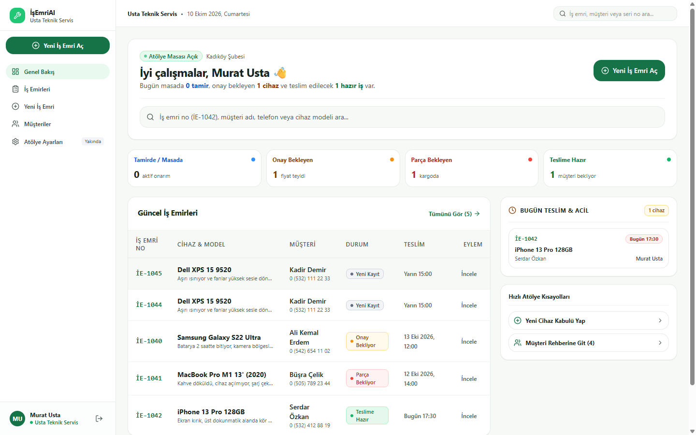
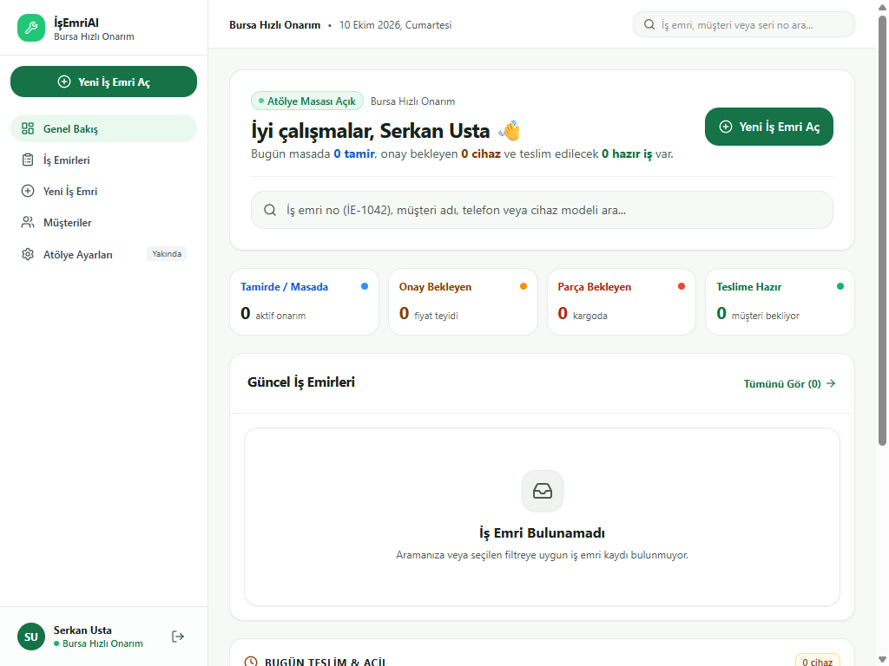
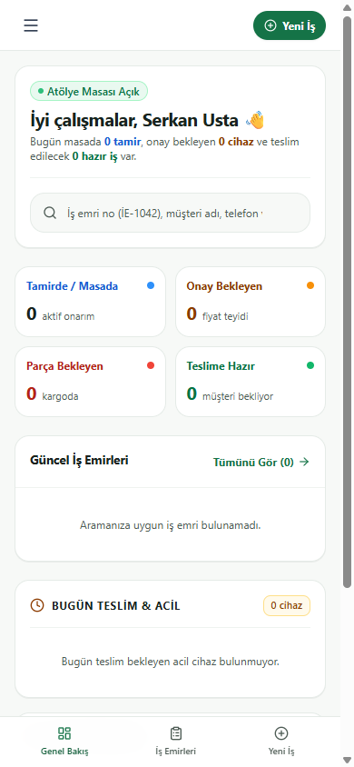
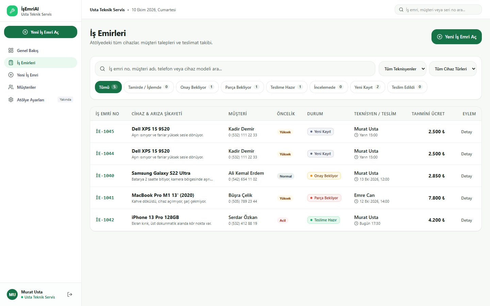
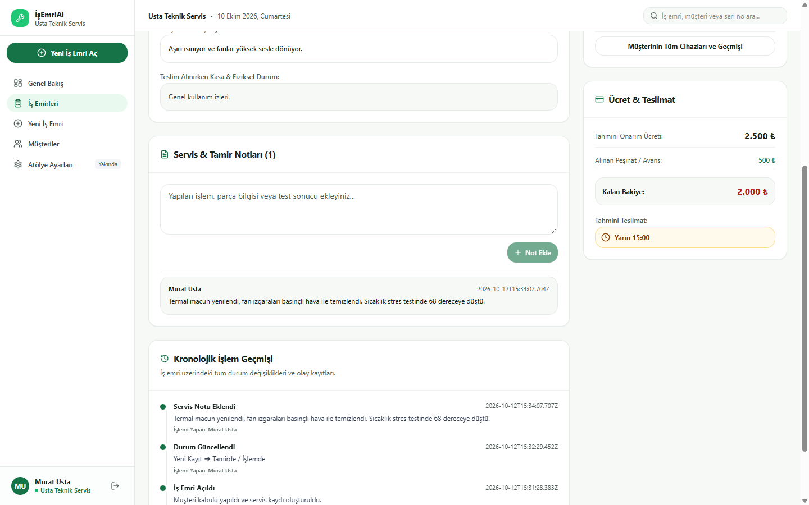
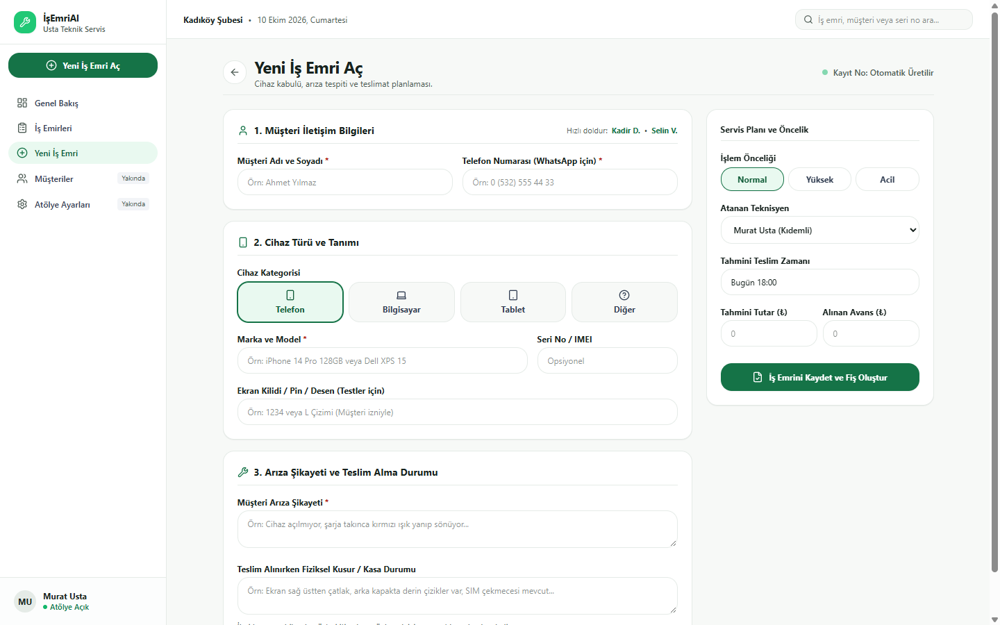
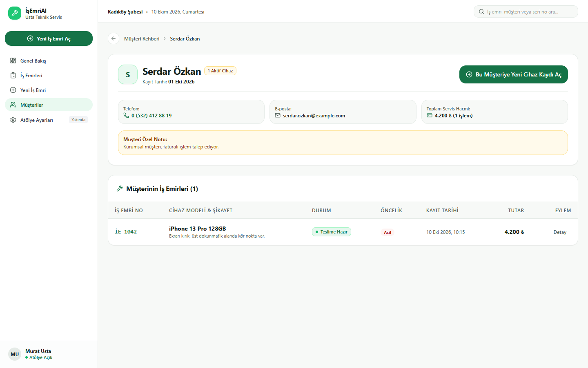
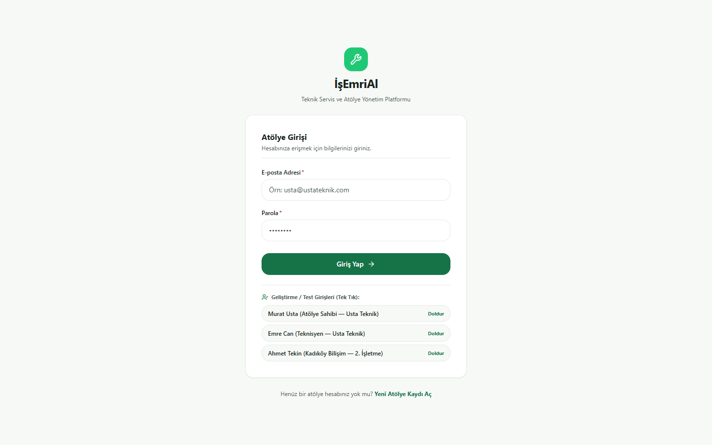
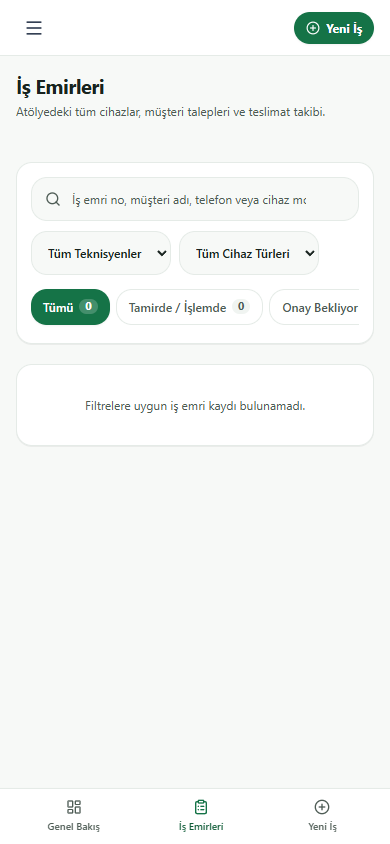
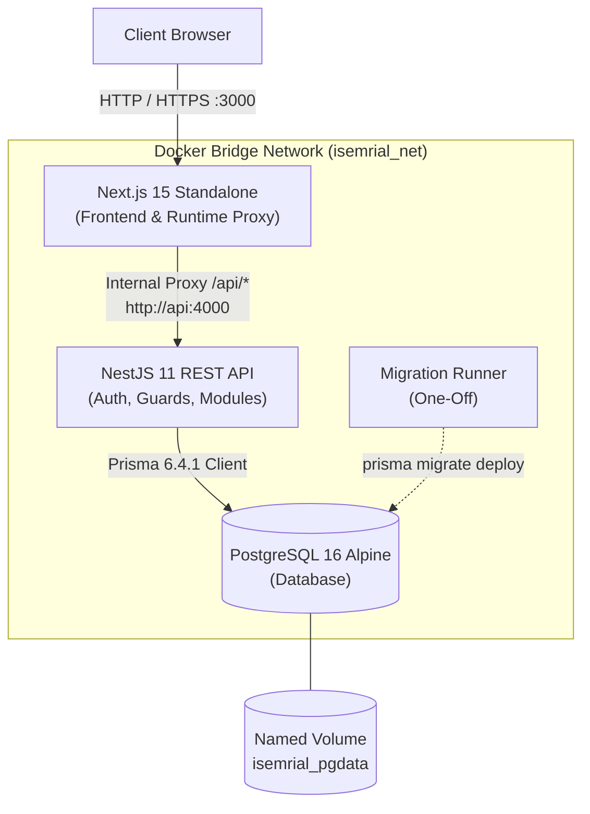

<div align="center">

# 🛠️ İşEmriAl

**Modern Workshop & Work Order Management Platform for Technical Repair Services**

[](https://nextjs.org/)
[](https://react.dev/)
[](https://www.typescriptlang.org/)
[](https://nestjs.com/)
[](https://www.prisma.io/)
[](https://www.postgresql.org/)
[](https://tailwindcss.com/)
[](https://www.docker.com/)

<p align="center">
  <a href="#-overview">Overview</a> •
  <a href="#-key-features">Features</a> •
  <a href="#-screenshots">Screenshots</a> •
  <a href="#-architecture">Architecture</a> •
  <a href="#-tech-stack">Tech Stack</a> •
  <a href="#-getting-started">Getting Started</a> •
  <a href="#-docker-deployment">Docker</a> •
  <a href="#-security">Security</a> •
  <a href="#-roadmap">Roadmap</a>
</p>

---



</div>

---

## 📖 Overview

**İşEmriAl** is an operations management SaaS built specifically for small technical repair shops (smartphone, computer, tablet, and electronics service workshops). 

Most small repair businesses still track active jobs using physical paper receipts, whiteboards, or unorganized messaging chats. This leads to lost diagnostic notes, forgotten deadlines, and customer disputes.

**İşEmriAl solves this by providing:**
- A clean, **light-first operational interface** tailored to the fast-paced daily workflow of technicians.
- Strict **multi-tenant data isolation**, guaranteeing that each workshop's customer records, repair logs, and financial metrics remain private.
- End-to-end **work order lifecycle management** from intake and diagnosis to quotation confirmation, parts procurement, completion, and delivery.
- Comprehensive **chronological repair timelines** and internal technician service notes.
- Quick **customer communication** via user-initiated WhatsApp (`wa.me`) message drafts.
- A **production-ready containerized deployment stack** with multi-stage Dockerfiles and isolated one-off migration runners.

---

## ✨ Key Features

### 📋 1. Work Order Lifecycle Management
- **Intake & Issue Description:** Collect customer details, device category (Phone, PC, Tablet, Other), brand/model, serial/IMEI, test lock pattern, and physical intake condition.
- **Operational Statuses:** Strict status flow (`Yeni Kayıt`, `İncelemede`, `Onay Bekliyor`, `Parça Bekliyor`, `Tamirde / İşlemde`, `Teslime Hazır`, `Teslim Edildi`, `İptal`).
- **Financial Tracking:** Estimated repair cost, upfront deposit received, and remaining balance calculated automatically.
- **Delivery Planning:** Target delivery date and time with urgent job alerts.

### 📜 2. Chronological Timeline & Service Notes
- **Event Audit Trail:** Every status transition, assignment change, and note addition is permanently logged in a timestamped timeline.
- **Technician Notes:** Technicians can record internal diagnostic details (e.g., thermal paste renewal, board-level repairs, part numbers).

### 👥 3. Customer Directory & Service History
- **Unified Customer Profile:** Name, phone, email, notes, and complete historical repair ticket ledger.
- **Quick Customer Lookup:** Auto-completion and fast telephone/name search during intake.
- **WhatsApp Integration:** Instant one-click `wa.me` draft links with ticket number and status to notify customers with technician consent.

### 🏢 4. Multi-Tenant Architecture & Scoped Metrics
- **Organization Scoping:** Every user belongs to an `Organization`. All database queries strictly scope to the active user's `organizationId`.
- **Scoped Dashboard Metrics:** Active repairs, awaiting approval, awaiting parts, ready for delivery, and total counts reflect strictly the active workshop.

### 🔒 5. Robust Security & Authentication
- **Secure Password Hashing:** Powered by **Argon2id**.
- **Server-Side Session Store:** Cookie-based signed session tokens linked to a database `Session` entity with expiration and revocation support.
- **Role-Based Access Control:** Role boundaries between `OWNER`, `MANAGER`, and `TECHNICIAN`.
- **Application Hardening:** Built-in security middleware (security headers, CORS origin verification, sliding-window rate limiting).

### 🐳 6. Containerization & Reproducible Deployment
- **Multi-Stage Builds:** Standalone Next.js runner (~65 MB) and NestJS API runner (~263 MB).
- **Non-Root Execution:** Containers run under dedicated non-root users (`nextjs:1001` and `node:1000`).
- **One-Off Migrations:** Migrations are executed via a dedicated runner (`docker compose run --rm migration`), preventing race conditions in replica scaling.
- **Dynamic Runtime Proxy:** Built-in API reverse proxy dynamically resolves `INTERNAL_API_URL` without build-time hardcoding.

---

## 📸 Screenshots

### Workshop Dashboard
| Desktop (1440px) | Tablet (1024px) | Mobile (390px) |
| :---: | :---: | :---: |
|  |  |  |

### Work Orders Management & Intake
| Work Orders List (Desktop) | Work Order Detail & Timeline |
| :---: | :---: |
|  |  |

| New Work Order Intake Form | Customer Profile & History |
| :---: | :---: |
|  |  |

### Authentication & Mobile View
| Workshop Login (Desktop) | Mobile Work Orders List |
| :---: | :---: |
|  |  |

---

## 🏛️ Architecture



### Request Lifecycle & Security Flow
1. **Client Request:** Browser interacts with Next.js frontend pages.
2. **API Proxy:** Next.js Route Handler (`src/app/api/[...path]/route.ts`) proxies `/api/*` calls to `http://api:4000`, appending cookies and client IP headers.
3. **Security Middleware:** NestJS inspects requests via `SecurityMiddleware` (Helmet headers, CORS origin check, Rate Limiting).
4. **Auth & Session Guard:** `AuthGuard` extracts the signed session cookie, validates the session token against the PostgreSQL `Session` table, and verifies expiration.
5. **Organization Scoping:** Controllers and services inject `@CurrentUser()`, enforcing `where: { organizationId: user.organizationId }` on all Prisma database operations.

---

## 💻 Tech Stack

| Layer | Technology | Version | Purpose |
| :--- | :--- | :---: | :--- |
| **Frontend Framework** | [Next.js](https://nextjs.org/) | `15.2.1` | App Router, Server Components & Standalone Output |
| **UI Library** | [React](https://react.dev/) | `19.0.0` | Declarative UI and component state |
| **Styling** | [Tailwind CSS](https://tailwindcss.com/) | `4.0.9` | Utility-first styling with custom design tokens |
| **Icons** | [Lucide React](https://lucide.dev/) | `1.16.0` | Accessible and consistent iconography |
| **Backend Framework** | [NestJS](https://nestjs.com/) | `11.0.0` | Modular TypeScript enterprise backend |
| **Database ORM** | [Prisma](https://www.prisma.io/) | `6.4.1` | Type-safe schema migrations & database client |
| **Database Engine** | [PostgreSQL](https://www.postgresql.org/) | `16` | Relational ACID database |
| **Password Hashing** | [Argon2](https://github.com/ranisalt/node-argon2) | `0.41.1` | Memory-hard cryptographic hashing |
| **Validation** | [class-validator](https://github.com/typestack/class-validator) | `0.14.1` | DTO validation and input sanitization |
| **Containerization** | [Docker](https://www.docker.com/) | `24+` | Container engine, Compose v2, Alpine images |
| **Package Manager** | [pnpm](https://pnpm.io/) | `9+ / 10+` | Fast, deterministic package management |

---

## 📁 Project Structure

```
isemrial/
├── .agents/                    # Workspace agent skills & customizations
├── Dockerfile                  # Multi-stage Next.js standalone container
├── docker-compose.yml          # Development & test Docker stack
├── docker-compose.prod.yml     # Production override (unexposed DB/API ports)
├── .dockerignore               # Build context ignore rules
├── .env.example                # Documented environment variables template
├── .gitignore                  # Git ignore rules
├── next.config.ts              # Next.js standalone configuration
├── package.json                # Frontend dependencies & scripts
├── pnpm-lock.yaml              # Frontend lockfile
├── docs/                       # Project architecture & phase documentation
│   ├── CONTAINER_RUNBOOK.md    # Container operation & disaster recovery guide
│   ├── DEPLOYMENT_READINESS.md # Pre-release hardening & readiness report
│   ├── DESIGN_SYSTEM.md        # Light-first UI tokens & accessibility guidelines
│   ├── GITHUB_RELEASE_AUDIT.md # Security scan, asset inventory & release audit
│   ├── STAGING_RUNBOOK.md      # Staging deployment & verification runbook
│   └── screenshots/            # Verified application screenshots
├── src/                        # Next.js frontend application
│   ├── app/                    # App Router pages (dashboard, work-orders, login)
│   │   ├── api/[...path]/      # Dynamic runtime API reverse proxy
│   │   ├── customers/          # Customer directory pages
│   │   ├── dashboard/          # Workshop analytics dashboard
│   │   ├── work-orders/        # Work orders list, new intake, ticket details
│   │   └── globals.css         # Design tokens and base styles
│   ├── components/             # Reusable UI components (AppShell, StatusBadge)
│   │   └── ui/                 # Accessible atomic design system primitives
│   ├── context/                # Client-side data and session context
│   └── lib/                    # API client utilities
└── backend/                    # NestJS API application
    ├── Dockerfile              # Multi-stage NestJS container
    ├── package.json            # Backend dependencies & scripts
    ├── pnpm-lock.yaml          # Backend lockfile
    ├── prisma/                 # Prisma ORM schema, migrations, and seed script
    │   ├── schema.prisma       # Database models (8 models)
    │   ├── migrations/         # Version-controlled SQL migrations
    │   └── seed.ts             # Development demo seed script
    ├── scripts/                # Operational scripts (session invalidation)
    └── src/                    # Backend source code
        ├── auth/               # Registration, login, logout, session logic
        ├── common/             # Guards, decorators, filters, security middleware
        ├── customers/          # Customer management module
        ├── health/             # Readiness and liveness health checks
        ├── organizations/      # Multi-tenant workshop settings
        └── work-orders/        # Work orders, timeline events, repair notes
```

---

## 🚀 Getting Started

### Prerequisites
- **Node.js:** v20.x or v22.x LTS
- **pnpm:** v9.x or v10.x (`npm install -g pnpm`)
- **Docker & Docker Compose:** Docker Desktop or Docker Engine 24+

---

### Option 1: Quickstart via Docker Compose (Recommended)

1. **Clone the repository:**
   ```bash
   git clone https://github.com/ErdemYy/isemrial.git
   cd isemrial
   ```

2. **Configure environment:**
   ```bash
   cp .env.example .env
   ```

3. **Build the container images:**
   ```bash
   docker compose build
   ```

4. **Start the database:**
   ```bash
   docker compose up -d db
   ```

5. **Run database migrations (One-Off Runner):**
   ```bash
   docker compose run --rm migration
   ```

6. **Start the application services:**
   ```bash
   docker compose up -d
   ```

7. **Verify health check:**
   ```bash
   curl http://localhost:3000/api/health
   ```
   *Expected response: `{"status":"ok","services":{"database":"healthy"}}`*

8. **Open the browser:** Navigate to **`http://localhost:3000`**.

---

### Option 2: Running Natively for Local Development

#### 1. Start PostgreSQL
```bash
docker compose up -d db
```

#### 2. Configure Backend
```bash
cd backend
cp .env.example .env
pnpm install
pnpm run prisma:generate
pnpm run prisma:deploy

# (Optional) Seed development demo data:
pnpm run prisma:seed

# Start NestJS in watch mode:
pnpm run start:dev
```
*Backend runs on `http://localhost:4000`.*

#### 3. Configure Frontend
Open a new terminal in the project root:
```bash
pnpm install
pnpm run dev
```
*Frontend runs on `http://localhost:3000`.*

---

## ⚙️ Environment Variables

Copy `.env.example` to `.env`. The key configuration variables include:

| Variable | Description | Default / Example | Required in Prod |
| :--- | :--- | :--- | :---: |
| `POSTGRES_USER` | PostgreSQL superuser username | `postgres` | Yes |
| `POSTGRES_PASSWORD` | PostgreSQL superuser password | `postgres` *(Change in Prod)* | Yes |
| `POSTGRES_DB` | Target database name | `isemrial_dev` | Yes |
| `DATABASE_URL` | Connection URI for Prisma ORM | `postgresql://...` | Yes |
| `PORT` | NestJS API listening port | `4000` | No |
| `NODE_ENV` | Runtime environment (`development` / `production`) | `production` | Yes |
| `SESSION_SECRET` | Cryptographic secret for signing session cookies | *(Min. 32 random chars)* | **CRITICAL** |
| `SESSION_MAX_AGE_DAYS` | Session validity duration in days | `7` | No |
| `FRONTEND_ORIGIN` | Allowed client origin for CORS and CSRF checks | `http://localhost:3000` | Yes |
| `INTERNAL_API_URL` | Internal URL for Next.js server-side API proxy | `http://api:4000` | Yes |
| `TRUST_PROXY` | Enables real IP resolution behind reverse proxies | `true` | Yes |
| `NEXT_PUBLIC_ENABLE_DEMO_LOGIN` | Enables 1-click test login cards on UI | `false` | Must be `false` |

> [!IMPORTANT]
> To generate a secure `SESSION_SECRET` for production:
> ```bash
> openssl rand -hex 32
> ```

---

## 🛡️ Security Architecture

- **Tenant Isolation:** Every record in `Customer`, `WorkOrder`, `TimelineEvent`, and `WorkOrderNote` is foreign-keyed to `Organization`. Services strictly filter by `organizationId`.
- **Argon2 Password Hashing:** User passwords are encrypted using memory-hard Argon2id parameters before database storage.
- **Revocable Sessions:** User sessions are stored in the database (`Session` entity). Revocation occurs immediately upon logout.
- **Post-Restore Session Invalidation:** A dedicated operational runbook ensures that whenever a database is restored from a backup, old sessions are automatically purged to prevent stale token reuse (see [docs/CONTAINER_RUNBOOK.md](docs/CONTAINER_RUNBOOK.md)).
- **Production Startup Validation:** NestJS validates mandatory configuration on bootstrap (`main.ts`). If `SESSION_SECRET` is too short or contains the default template in production, the server aborts startup immediately.
- **Reverse Proxy Requirement:** In public production deployments, TLS/HTTPS must be terminated by a dedicated reverse proxy (Nginx, Caddy, Cloudflare, Traefik).

---

## 🧪 Testing & Quality Assurance

İşEmriAl features automated end-to-end and integration test suites:

| Test Suite | Scope | Execution Command |
| :--- | :--- | :--- |
| **Docker Deployment E2E** | Multi-container network, web proxy, auth, work orders, container restart, named volume persistence | `cd backend && pnpm dlx tsx test-container-deployment.ts` |
| **Tenant Metrics Isolation** | Cross-tenant metric isolation across multiple workshops | `cd backend && pnpm dlx tsx test-metrics-isolation.ts` |
| **Session & Restore Security** | Post-restore session revocation and token invalidation | `cd backend && pnpm dlx tsx test-session-restore-security.ts` |
| **Security & Rate Limiting** | Sliding-window auth rate limits, CSRF origin checks, brute force defense | `cd backend && pnpm dlx tsx test-phase5-1.ts` |
| **Core API & DTO Validation** | End-to-end CRUD, status transitions, schema validation | `cd backend && pnpm dlx tsx test-api.ts` |

---

## 🗺️ Roadmap & Current Status

**Current Status:** **Release Candidate 1 (RC-1)**  
- [x] Phase 1–3: Core UI, Light-first Design System, WCAG 2.2 AA Contrast Compliance
- [x] Phase 4: Secure NestJS Backend, PostgreSQL & Prisma Multi-Tenant Architecture
- [x] Phase 5: Security Hardening, Rate Limiting & Staging Verification
- [x] Phase 5.3: Multi-Stage Dockerization, Non-Root Runners & One-Off Migration Runner

**Planned Enhancements:**
- [ ] Public HTTPS Staging & Cloud Deployment
- [ ] Automated CI/CD Pipeline (GitHub Actions)
- [ ] Role-based granular permission editor
- [ ] Multi-store inventory / spare parts tracking module
- [ ] SMS / Email notification provider webhook integration
- [ ] Off-site encrypted automated backup synchronization

---

## 🤝 Contributing

Contributions, issues, and feature suggestions are welcome! Please check our [CONTRIBUTING.md](CONTRIBUTING.md) guide before submitting a pull request.

---

## 📄 License & Disclaimer

- **License:** No license has been specified yet. All rights reserved by the repository owner.
- **Operational Copy:** The application interface is designed in natural Turkish, targeting technical workshops in Turkey. English documentation is maintained for international developer accessibility.
- **Representative Data:** All sample organizations, technicians, and repair tickets presented in screenshots and seed scripts are fictional demo fixtures.

---

<div align="center">
  <sub>Developed by <a href="https://github.com/ErdemYy">ErdemYy</a> • Built with Next.js, NestJS, Prisma & Docker</sub>
</div>
