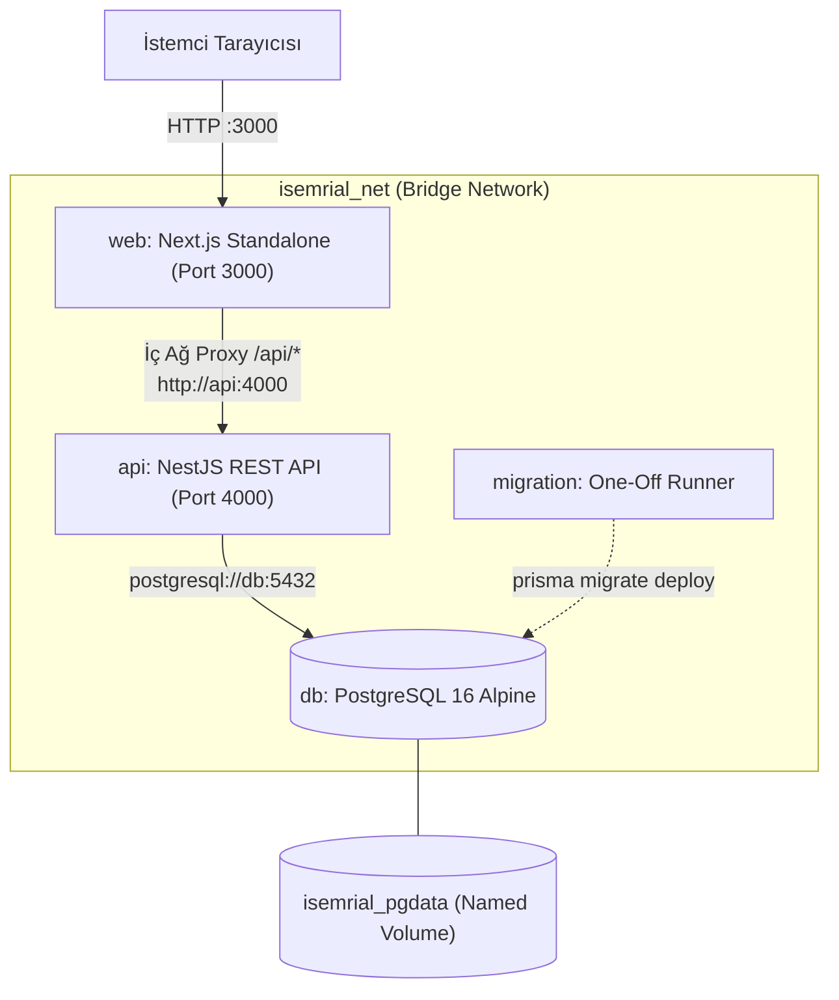

# İŞEMRİAL — KONTEYNER İŞLETİM VE DAĞITIM KILAVUZU (CONTAINER RUNBOOK)

**Sürüm:** Faz 5.3  
**Tarih:** 12 Ekim 2026  
**Hedef Kitle:** DevOps Mühendisleri, Sistem Yöneticileri, Backend Mimarları ve QA Ekipleri  
**Kapsam:** Docker Container Mimarisi, Multi-stage Build, Servis Yönetimi, One-off Migration, Yedekleme, Kurtarma ve Oturum Güvenliği  

---

## 1. Genel Bakış ve Mimari

İşEmriAl, modern bulut ve konteyner altyapılarında (Docker Compose, Docker Swarm, Kubernetes) tekrarlanabilir ve güvenli şekilde çalıştırılmak üzere containerize edilmiştir.

### 1.1 Mimarî Şema



### 1.2 Servis Envanteri

| Servis | İmaj Adı | Temel İmaj | Kullanıcı (UID) | Konteyner Portu | Host Portu (Dev) | Host Portu (Prod) | Healthcheck |
| :--- | :--- | :--- | :--- | :---: | :---: | :---: | :--- |
| **`web`** | `iemrial-web:latest` | `node:20-alpine` | `nextjs` (1001) | 3000 | `3000:3000` | `3000:3000` (veya Reverse Proxy) | `wget -qO- http://localhost:3000/api/health` |
| **`api`** | `iemrial-api:latest` | `node:20-alpine` | `node` (1000) | 4000 | `127.0.0.1:4000:4000` | **Kapalı (Yayınlanmaz)** | `wget -qO- http://localhost:4000/api/health` |
| **`db`** | `postgres:16-alpine` | Alpine Linux | `postgres` (70) | 5432 | `127.0.0.1:5433:5432` | **Kapalı (Yayınlanmaz)** | `pg_isready -U postgres` |
| **`migration`**| `iemrial-api:latest` | `node:20-alpine` | `node` (1000) | - | - | - | One-off işlem |

---

## 2. Ön Koşullar ve Hazırlık

Konteyner yığınını çalıştırmak için asgari gereksinimler:
- **Docker Engine:** 24.0 veya üzeri
- **Docker Compose:** v2.20 veya üzeri
- **Bellek:** Asgari 2 GB RAM (Derleme sırasında 4 GB önerilir)
- **Disk:** Asgari 5 GB boş alan

### 2.1 Ortam Dosyasının Hazırlanması

Kök dizinde `.env` dosyası oluşturulmalıdır:

```bash
cp .env.example .env
```

Üretim ortamı için `.env` içeriği örneği:

```ini
# --- VERİTABANI (DOCKER AĞI) ---
POSTGRES_USER=isemrial_admin
POSTGRES_PASSWORD=VERY_SECURE_STRONG_DB_PASSWORD_CHANGEME
POSTGRES_DB=isemrial_production
# Not: Konteynerler arası bağlantıda host adı daima 'db' olmalıdır:
DATABASE_URL=postgresql://isemrial_admin:VERY_SECURE_STRONG_DB_PASSWORD_CHANGEME@db:5432/isemrial_production?schema=public

# --- GÜVENLİK VE OTURUM ---
NODE_ENV=production
# SESSION_SECRET asgari 32 karakterlik rastgele güvenli dizi olmalıdır:
SESSION_SECRET=PROD_VERY_SECURE_SESSION_SECRET_AT_LEAST_32_CHARS_CHANGEME
SESSION_MAX_AGE_DAYS=7
FRONTEND_ORIGIN=http://localhost:3000
INTERNAL_API_URL=http://api:4000
TRUST_PROXY=true

# --- ÖZELLİK VE GİRİŞ KONTROLLERİ ---
NEXT_PUBLIC_ENABLE_DEMO_LOGIN=false
```

> [!WARNING]
> Üretim ortamında `NEXT_PUBLIC_ENABLE_DEMO_LOGIN` kesinlikle `false` olmalı ve `SESSION_SECRET` rastgele üretilmiş güçlü bir anahtar olmalıdır.

---

## 3. İmajları Derleme (Build)

İmajlar çok aşamalı (multi-stage) olarak ve bağımlılık önbelleğinden en yüksek verimi alacak şekilde derlenir.

```bash
# Tüm imajları önbelleksiz veya en güncel kodla derleyin
docker compose build --no-cache
```

Tekil olarak derlemek için:

```bash
# Yalnızca Web frontend imajı
docker build -t iemrial-web:latest -f Dockerfile .

# Yalnızca API backend imajı
docker build -t iemrial-api:latest -f backend/Dockerfile backend
```

### İmaj Güvenliği ve Optimizasyonu:
- **Root Olmayan Kullanıcı:** Web `nextjs` (UID 1001), API `node` (UID 1000) kullanıcısıyla çalışır. Konteyner içi yetki yükseltme (privilege escalation) riski önlenmiştir.
- **Minimal Boyut:** Web imajı Next.js `standalone` çıktısıyla sadece ~65 MB, API imajı ise ~263 MB boyuta sahiptir.
- **Gizli Veri Korunması:** `.dockerignore` dosyaları sayesinde `.env`, test dosyaları, Git geçmişi imaj katmanlarına dahil edilmez.

---

## 4. Veritabanı Migration Yönetimi (One-off Migration)

> [!IMPORTANT]
> **Kritik Kural:** Migration işlemleri uygulama (`api` veya `web`) konteynerinin her başlangıcında kontrolsüzce çalıştırılmaz. Çoklu replika (replica scaling) durumlarında veritabanı kilitlenmelerini ve yarış durumlarını (race conditions) önlemek için migration **tek seferlik one-off komut** ile çalıştırılır.

### Adım 1: Veritabanı Servisinin Hazır Olması
```bash
docker compose up -d db
```

### Adım 2: One-off Migration Konteynerini Çalıştırma
```bash
docker compose run --rm migration
```

Bu komut:
1. `iemrial-api` imajını kullanarak izole bir geçici konteyner açar.
2. `node_modules/.bin/prisma migrate deploy` komutunu çalıştırır.
3. Bekleyen migration'ları sırayla uygular.
4. Başarıyla tamamlandığında (Exit code 0) konteyneri otomatik olarak siler (`--rm`).

### Migration Durumunu Kontrol Etme
```bash
docker compose run --rm migration node_modules/.bin/prisma migrate status
```

---

## 5. Servislerin Başlatılması ve Yönetimi

### 5.1 Yerel Geliştirme / Test Profili
Yerel ortamda DB ve API portlarına dışarıdan da erişilmek istendiğinde varsayılan `docker-compose.yml` kullanılır:

```bash
# Servisleri arka planda başlat
docker compose up -d

# Logları canlı takip et
docker compose logs -f

# Durumu ve sağlık kontrollerini doğrula
docker compose ps
```

### 5.2 Üretim Profili (Production Compose)
Üretim ortamında PostgreSQL (5432) ve API (4000) portları host makineye açılmamalıdır. Yalnızca web arayüzü (3000) yayınlanır:

```bash
# Üretim override dosyası ile başlat
docker compose -f docker-compose.yml -f docker-compose.prod.yml up -d
```

### 5.3 Servis Sağlık Durumu (Healthcheck) Doğrulama

Konteynerlerin sağlıklı durumda olduğu doğrulanmalıdır:

```bash
# Konteyner durumları
docker compose ps

# Web üzerinden uçtan uca sağlık kontrolü
curl -i http://localhost:3000/api/health
```

Beklenen Yanıt:
```json
HTTP/1.1 200 OK
Content-Type: application/json; charset=utf-8

{
  "status": "ok",
  "timestamp": "2026-10-12T18:31:02.570Z",
  "services": {
    "database": "healthy"
  }
}
```

---

## 6. Yedekleme, Geri Yükleme ve Oturum Güvenliği

### 6.1 Canlı Veritabanı Yedeği Alma (Backup)

```bash
# Tarihli yedek dosyası oluştur
BACKUP_FILE="backup_isemrial_$(date +%Y%m%d_%H%M%S).sql"

docker exec isemrial_postgres pg_dump -U postgres -d isemrial_production --clean --if-exists > "$BACKUP_FILE"
```

### 6.2 Test Ortamında Geri Yükleme Doğrulaması (Restore Verification)

Üretim yedeği doğrudan canlı sisteme yüklenmez; önce izole bir test veritabanında test edilir:

```bash
# 1. İzole test veritabanı oluştur
docker exec isemrial_postgres psql -U postgres -c "CREATE DATABASE isemrial_restore_test;"

# 2. Yedeği test veritabanına yükle
cat "$BACKUP_FILE" | docker exec -i isemrial_postgres psql -U postgres -d isemrial_restore_test

# 3. Tablo ve satır sayılarını doğrula
docker exec isemrial_postgres psql -U postgres -d isemrial_restore_test -c "
SELECT 'users' as tbl, count(*) FROM \"User\"
UNION ALL
SELECT 'organizations', count(*) FROM \"Organization\"
UNION ALL
SELECT 'work_orders', count(*) FROM \"WorkOrder\";"
```

### 6.3 Geri Yükleme Sonrası Oturum Güvenliği (Post-Restore Invalidation)

> [!CAUTION]
> **Güvenlik Kuralı:** Veritabanı geri yüklendiğinde, yedekleme anında aktif olan kullanıcı oturumları (Session) ve yetkilendirmeleri tekrar aktif hâle gelebilir. Veritabanı geri yüklendikten sonra tüm kullanıcı oturumları derhal geçersiz kılınmalıdır.

#### Yöntem 1: Veritabanı Oturumlarını Sıfırlama (Önerilen)
```bash
docker exec isemrial_postgres psql -U postgres -d isemrial_production -c "DELETE FROM \"Session\";"
```

#### Yöntem 2: Oturum Secret Değişimi (Global Session Invalidation)
Sunucu seviyesinde tüm JWT / çerez oturumlarını anında düşürmek için `.env` dosyasındaki `SESSION_SECRET` anahtarı yenilenir ve servis yeniden başlatılır:

```bash
# .env dosyasında SESSION_SECRET değerini yeni bir anahtar ile değiştirin
docker compose restart api
```

---

## 7. Servisleri Durdurma ve Temizleme

### 7.1 Geçici Olarak Durdurma (Veriler Korunur)
```bash
docker compose stop
```

### 7.2 Konteynerleri ve Ağı Kaldırma (Named Volume Korunur)
```bash
docker compose down
```
*Not: `isemrial_pgdata` named volume silinmediği için tüm veritabanı kayıtları aynen korunur.*

### 7.3 Tam Temizlik (Yalnızca Test Ortamı — DİKKAT!)
```bash
# TEHLİKE: Tüm veritabanı volume'unu siler! Üretimde asla çalıştırmayın!
docker compose down -v
```

---

## 8. Sık Karşılaşılan Sorunlar ve Çözümleri (Troubleshooting)

### Sorun 1: Web Servisi 502 Bad Gateway Veriyor
- **Belirti:** `http://localhost:3000/api/...` çağrıldığında 502 dönüyor.
- **Neden:** `api` konteyneri henüz başlamamış, çökmüş veya `INTERNAL_API_URL` adresi yanlış.
- **Çözüm:**
  ```bash
  docker compose logs api
  # API sağlık kontrolünü doğrula
  docker inspect --format='{{.State.Health.Status}}' isemrial_api
  ```

### Sorun 2: Migration Konteyneri Veritabanına Bağlanamıyor
- **Belirti:** `Can't reach database server at db:5432` hatası.
- **Neden:** `db` konteyneri henüz `healthy` durumuna gelmemiştir veya ağ köprüsü kapalıdır.
- **Çözüm:**
  ```bash
  docker compose ps db
  # DB'nin sağlıklı olduğundan emin olun
  docker inspect --format='{{.State.Health.Status}}' isemrial_postgres
  ```

### Sorun 3: API Konteyneri Çöküyor (CrashLoop)
- **Belirti:** `api` servisi duruyor (`Exited with code 1`).
- **Neden:** `NODE_ENV=production` modunda `SESSION_SECRET` 32 karakterden kısa veya `DATABASE_URL` tanımsız.
- **Çözüm:** `.env` dosyasındaki `SESSION_SECRET` değerinin en az 32 karakter olduğunu kontrol edin.
