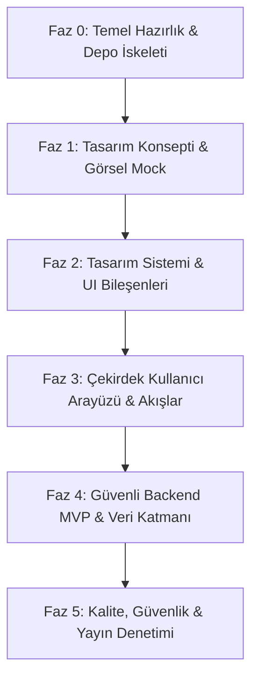

# İşEmriAl — Geliştirme Uygulama ve Test Planı (Implementation Plan)
**Tarih:** 10 Ekim 2026  
**Rol:** Ürün Mimarı, Kıdemli Full-Stack Geliştirici, Ürün Tasarımcısı  
**Referans Dokümanlar:** `AGENTS.md`, `premium-saas-ui/SKILL.md`, `PRODUCT_BRIEF.md`, `DESIGN_SYSTEM.md`, `UX_FLOWS.md`, `TECHNICAL_PLAN.md`  

---

## 1. Uygulama Prensipleri ve Metodoloji

İşEmriAl geliştirme süreci şu katı kurallara bağlıdır:
1. **Tek Seferde Değil, Aşamalı Üretim:** Tüm arayüz ve backend tek bir devasa adımda üretilmez. Önce konsept, sonra tasarım sistemi, ardından çekirdek ekranlar ve en son veri katmanı inşa edilir.
2. **Kanıtsız Başarı İddiası Yok:** Gerçekte çalıştırılmayan build, lint veya testler asla “başarılı” olarak raporlanamaz.
3. **Mevcut Çalışan Yapıyı Koruma:** Geliştirme süresince çalışan mimari korunur; kanıtlanmamış kütüphane değişimleri yapılmaz.
4. **Tek ORM Kuralı:** Proje genelinde yalnızca tek bir ORM (Prisma) kullanılır; çift ORM çatışmasına izin verilmez.
5. **Görsel Kalite Önceliği:** Varsayılan tema açık (light-first), sakin, operasyonel ve işlevseldir. AI dashboard klişeleri (karanlık tema, neon parıltılar, cam efektleri, 4 dev KPI kutusu) yasaktır.

---

## 2. Aşamalı Geliştirme Yol Haritası

---

### Faz 0: Temel Hazırlık ve Depo Standartları
* **Hedef:** Çalışma ortamını temiz, sürümlenebilir ve güvenli bir şekilde geliştirmeye hazır hale getirmek.
* **Kapsam:**
  - `git init` çalıştırılması, standart `.gitignore` oluşturulması.
  - Windows PowerShell yürütme politikasına uyumlu paket yöneticisi standardının (`pnpm.cmd` veya `powershell -ExecutionPolicy Bypass`) netleştirilmesi.
  - Frontend proje çatısının (Next.js 15+ App Router, TypeScript, Tailwind CSS v4) temiz bir şekilde yapılandırılması.
* **Oluşturulacak / Düzenlenecek Dosyalar:**
  - `.gitignore`
  - `package.json`, `tsconfig.json`
  - `next.config.ts`, `postcss.config.mjs`
* **Kabul Kriterleri (DoD):**
  - `pnpm build` veya `npm run build` komutunun hatasız tamamlanması.
  - Depo kökünde gereksiz geçici dosyaların (`node_modules`, `.next`, `.env`) git tarafından izlenmemesi.
* **Test & Doğrulama:**
  - Derleme testi: `pnpm build` çalıştırılmalı ve çıkış kodu `0` olmalı.
* **Geri Dönüş Planı:**
  - Hatalı paket yapılandırmasında `git reset --hard` ve `node_modules` temizliği.

---

### Faz 1: Tasarım Konsepti ve Görsel Prototip (Prompt 01)
* **Hedef:** Tüm ekranları üretmeden önce uygulamanın görsel karakterini, renk dengesini, tipografisini ve bilgi hiyerarşisini 3 ana ekranda doğrulamak.
* **Kapsam:**
  1. **Dashboard (Genel Bakış):** Tek belirgin “Yeni İş Emri” CTA'sı, 3 anlamlı mini KPI (Bekleyen, Onay Bekleyen, Parça Bekleyen), güncel iş emirleri tablosu, geciken/bugünkü teslimler.
  2. **İş Emirleri Listesi:** Yoğun ama nefes alan tablo, arama kutusu, durum/öncelik filtreleme çubuğu, satır içi eylemler.
  3. **Yeni İş Emri:** Temiz bölümlendirilmiş form (Müşteri, Cihaz, Arıza, Öncelik, Sorumlu, Teslim Tarihi, Özet).
* **Oluşturulacak Dosyalar:**
  - `src/app/layout.tsx`, `src/app/globals.css` (Temel renk token'ları)
  - `src/app/concept/dashboard/page.tsx`
  - `src/app/concept/work-orders/page.tsx`
  - `src/app/concept/work-orders/new/page.tsx`
  - `src/mocks/concept-data.ts` (Gerçekçi Türkçe mock veri seti)
* **Kabul Kriterleri:**
  - Açık tema (kırık beyaz zemin `#F6F7F9`, beyaz yüzeyler `#FFFFFF`, koyu slate metin `#17212F`, kontrollü kobalt mavi `#315EDB`).
  - Siyah karanlık arka plan, neon mor gradient veya cam efekti içermemesi.
  - 1440px masaüstü ve 390px mobil ekranlarda sıfır yatay taşma (no horizontal scrollbar).
* **Test & Doğrulama Planı:**
  - Playwright ile yerel dev sunucuda 1440px ve 390px ekran görüntüleri alınması.
  - Görsel denetim listesi üzerinden tasarım kusurlarının raporlanması.
* **Geri Dönüş Planı:**
  - Tasarım yönü onaylanmazsa token'lar ve CSS kuralları `globals.css` üzerinden revize edilir.

---

### Faz 2: Tasarım Sistemi ve Temel Bileşenler (Prompt 02)
* **Hedef:** Faz 1'de onaylanan görsel dili modüler, erişilebilir ve yeniden kullanılabilir UI bileşenlerine dönüştürmek.
* **Kapsam:**
  - CSS Custom Properties / Semantic Design Tokens.
  - `Button` (Primary, Secondary, Outline, Ghost, Destructive; Loading & Disabled durumları).
  - `Input`, `Select`, `Textarea`, `FormField` (Etiket, ipucu, hata mesajı, focus ring).
  - `StatusBadge` (9 durum için metin + renkli nokta/zemin eşlemesi).
  - `DataTable` (Sıralama, filtreleme, satır eylemleri, boş durum, yüklenme skeleton'ı).
  - `Dialog` & `Drawer` (Erişilebilir başlık, kapatma odağı, mobil tam sayfa adaptasyonu).
  - `Toast` (Sonner entegrasyonu, bildirimler).
  - `EmptyState` ve `Skeleton` (Gerçek düzen ölçüleriyle uyumlu iskelet yükleyiciler).
  - `DesignSystemShowcase` sayfası (`/design-system`).
* **Oluşturulacak Dosyalar:**
  - `src/components/ui/button.tsx`, `src/components/ui/input.tsx`, `src/components/ui/badge.tsx` vb.
  - `src/components/ui/data-table.tsx`, `src/components/ui/dialog.tsx`
  - `src/app/design-system/page.tsx`
* **Kabul Kriterleri:**
  - Bileşenlerde rastgele hex renk ve keyfî piksel değerleri bulunmamalı, tamamı token'lara bağlı olmalı.
  - Klavye odağı (`focus-visible`) tüm interaktif elemanlarda net ve yüksek kontrastlı olmalı.
  - Butonlar aşırı yuvarlak pill şekline dönüştürülmemeli (8-10px radius korunmalı).
* **Test & Doğrulama Planı:**
  - Typecheck: `pnpm tsc --noEmit`.
  - Lint: `pnpm lint`.
  - Vitest / Jest: Temel bileşen birim testleri (render ve disabled halleri).
* **Geri Dönüş Planı:**
  - Hatalı bileşenler `/components/ui/` altında bağımsız olarak refactor edilir.

---

### Faz 3: Çekirdek Kullanıcı Arayüzü ve Akışlar (Prompt 03)
* **Hedef:** Küçük teknik servislerin günlük operasyonunu yürüteceği tüm ana rotaları eksiksiz etkileşim ve mock durumlarla inşa etmek.
* **Kapsam:**
  1. `/dashboard`: Günlük operasyon masası, geciken işler, hızlı aksiyonlar.
  2. `/work-orders`: Dinamik durum sekmeleri, serbest arama, sıralama, sayfalama.
  3. `/work-orders/new`: Adımlı/bölümlü form, anlık müşteri seçimi veya hızlı müşteri ekleme diyaloğu.
  4. `/work-orders/[id]`: İş emri detay kartı, kronolojik durum geçmişi, servis notu ekleme, kullanılan parça listesi, hazır WhatsApp mesaj taslağı modalı (`wa.me` bağlantılı).
  5. `/customers` & `/customers/[id]`: Müşteri rehberi, geçmiş işler, iletişim bilgileri.
  6. `/settings/workshop` & `/settings/team`: Atölye çalışma saatleri, teknisyen listesi.
* **Oluşturulacak Dosyalar:**
  - `src/app/(app)/dashboard/page.tsx`
  - `src/app/(app)/work-orders/page.tsx`, `src/app/(app)/work-orders/[id]/page.tsx`
  - `src/app/(app)/customers/page.tsx`, `src/app/(app)/customers/[id]/page.tsx`
  - `src/app/(app)/settings/page.tsx`
  - `src/mocks/service-store.ts` (Reaktif frontend mock durum yöneticisi)
* **Kabul Kriterleri:**
  - Her sayfada Loading, Empty, Error ve Success durumlarının çalışır vaziyette olması.
  - Tıklanan her butonun anlamlı bir işlem yapması (mock veri üzerinde güncelleme veya toast mesajı).
  - Türkçe para (TL), tarih (`10 Ekim 2026, 14:30`) ve telefon formatlarının (`0 (5XX) XXX XX XX`) tutarlı olması.
* **Test & Doğrulama Planı:**
  - 1440px masaüstü, 1024px tablet ve 390px mobil ekranlarda Playwright ile test.
  - Form validasyonlarının boş ve geçersiz girdilerde Türkçe hata metinleri ürettiğinin kontrolü.
* **Geri Dönüş Planı:**
  - Her rota bağımsız route segmenti olduğu için bozulan sayfa izole edilip düzeltilebilir.

---

### Faz 4: Güvenli Backend MVP ve Veritabanı Entegrasyonu (Prompt 04)
* **Hedef:** Güvenli, çok kiracılı (multi-tenant) veri modeli, kimlik doğrulama ve gerçek API uç noktalarının entegrasyonu.
* **Kapsam:**
  - Prisma şeması: `User`, `Organization`, `Membership`, `Customer`, `Device`, `WorkOrder`, `StatusHistory`, `Note`, `Attachment`.
  - Docker Compose ile yerel PostgreSQL veritabanı ortamı.
  - Migration'lar ve geliştirme ortamı için gerçekçi Türkçe tohumlama (seed) verisi.
  - HttpOnly Cookie tabanlı oturum yönetimi (JWT / Session token).
  - Zorunlu Organizasyon Kapsamı: Her sorguda `organizationId` doğrulaması.
  - REST API / Route Handlers:
    - `POST /api/auth/login`, `POST /api/auth/logout`, `GET /api/auth/me`
    - `GET/POST /api/work-orders`, `GET/PATCH /api/work-orders/:id`, `POST /api/work-orders/:id/status`
    - `GET/POST /api/customers`, `GET /api/customers/:id`
  - Frontend mock katmanının gerçek API çağrılarına bağlanması.
* **Oluşturulacak Dosyalar:**
  - `prisma/schema.prisma`, `prisma/seed.ts`
  - `docker-compose.yml`
  - `src/lib/db.ts`, `src/lib/auth.ts`
  - `src/app/api/...` uç noktaları
* **Kabul Kriterleri:**
  - Başka bir atölyeye ait iş emri ID'si girildiğinde API'nin `404 Not Found` veya `403 Forbidden` dönmesi (IDOR koruması).
  - Durum değişikliklerinin otomatik olarak `StatusHistory` tablosuna audit kaydı düşmesi.
  - Geliştirici ortamı dışında seed çalıştırılmasının engellenmesi.
* **Test & Doğrulama Planı:**
  - Veritabanı izolasyon testi: A organizasyonu kullanıcısı ile B organizasyonuna ait kayıt sorgulanıp reddedildiği doğrulanır.
  - API entegrasyon testleri (Supertest veya Vitest API suite).
* **Geri Dönüş Planı:**
  - Prisma migration geri alma (`prisma migrate resolve --rolled-back`) ve API rollback.

---

### Faz 5: Kalite, Güvenlik ve Yayın Denetimi (Prompt 05)
* **Hedef:** Tüm sistemin görsel, teknik, erişilebilirlik ve operasyonel kalite standartlarına uygunluğunu tescillemek.
* **Kapsam:**
  - 1440px, 1024px ve 390px çözünürlüklerde tam kapsamlı görsel denetim (Visual QA).
  - WCAG AA erişilebilirlik kontrolü: Yeterli kontrast, klavye ile form doldurma, focus-visible görünürlüğü.
  - OWASP Top 10 kontrolleri: SQL injection (ORM parametreli sorguları), XSS koruması, güvenli header'lar.
  - `docs/RELEASE_AUDIT.md` raporunun hazırlanması.
* **Kabul Kriterleri:**
  - Sıfır konsol hatası (console error / warning).
  - Sıfır hydration uyarısı.
  - `pnpm build`, `pnpm lint`, `pnpm test` komutlarının tamamının PASS vermesi ve raporlanması.
* **Test & Doğrulama:**
  - CI/CD build ve test simülasyonu.
  - Playwright çoklu cihaz ekran görüntüsü arşivi.

---

## 3. Test ve Doğrulama Matrisi

| Faz | Test Türü | Komut / Araç | Başarı Ölçütü |
| :--- | :--- | :--- | :--- |
| **Faz 0** | Derleme & Tip | `pnpm build`, `pnpm tsc --noEmit` | Exit code 0, 0 error |
| **Faz 1** | Görsel & Düzen | Playwright (1440px, 390px) | Taşma yok, kontrast yeterli, açık tema |
| **Faz 2** | Birim & Lint | `pnpm lint`, `pnpm test` | Kurallara tam uyum |
| **Faz 3** | UI & Durum | Playwright & Manuel etkileşim | Loading/Empty/Error/Success eksiksiz |
| **Faz 4** | Güvenlik & İzolasyon | Entegrasyon testleri | Tenant izolasyonu %100 doğrulanmış |
| **Faz 5** | Tam Regresyon | E2E + Audit | Sıfır console error, tam rapor |
