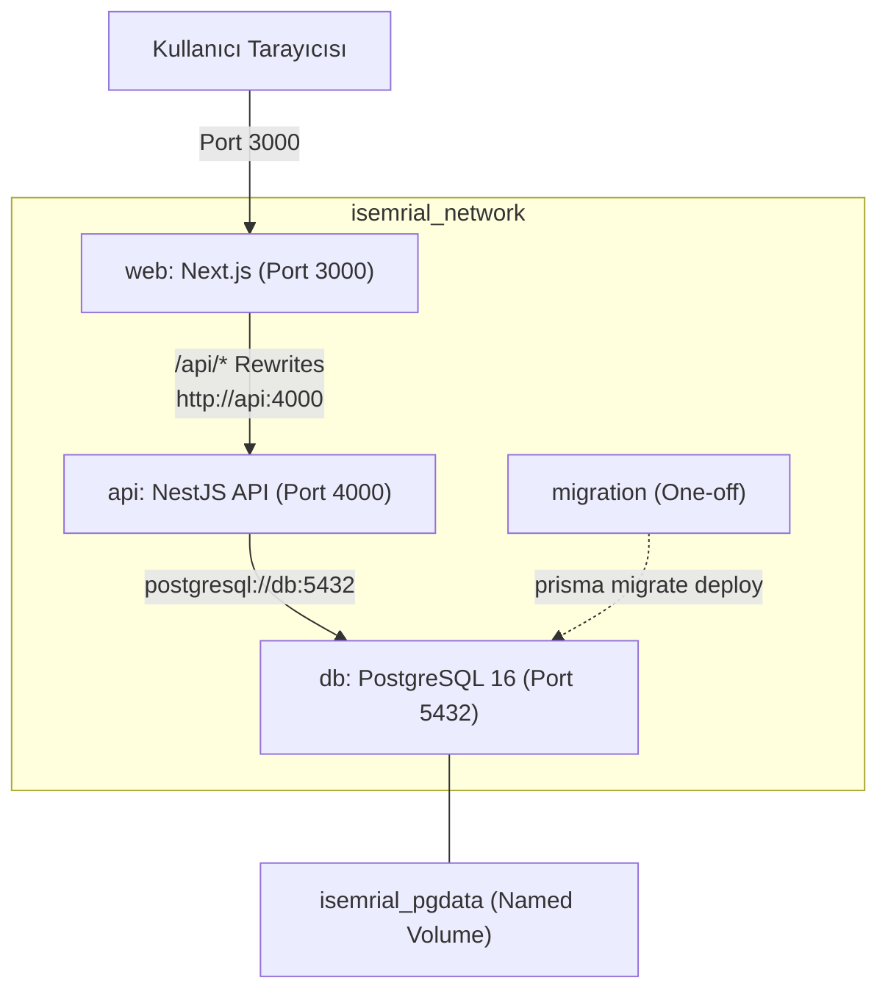

# İŞEMRİAL — FAZ 5.3: CONTAINERIZATION VE TEKRARLANABİLİR DAĞITIM DENETİMİ (AUDIT)

**Tarih:** 12 Ekim 2026  
**Aşama:** Faz 5.3 — Containerization, Docker Mimarisi ve Tekrarlanabilir Dağıtım Hazırlığı  
**Roller:** Kıdemli DevOps Mühendisi, Backend Mimarı, Uygulama Güvenliği Mühendisi, QA Sorumlusu  
**Doküman Kodu:** `PHASE_5_3_AUDIT`

---

## 1. Giriş ve Amaç

İşEmriAl projesinde Faz 0'dan Faz 5.2.2'ye kadar olan aşamalarda çekirdek ürün özellikleri, kullanıcı arayüzü, NestJS REST API, çok kiracılı PostgreSQL veritabanı, güvenlik sertleştirmesi ve veri kurtarma denetimleri tamamlanmıştır.

Mevcut durumda:
- PostgreSQL veritabanı Docker konteyneri (`isemrial_postgres`) olarak çalışmaktadır.
- NestJS backend ve Next.js frontend ise yerel host üzerinde Node.js süreçleri olarak (`node dist/src/main.js` ve `pnpm start`) çalıştırılmaktadır.
- İletişim `localhost:3000` -> `localhost:4000` -> `localhost:5433` zinciri üzerinden yürümektedir.

**Faz 5.3'ün Amacı:**
Mevcut çalışan kod tabanına zarar vermeden, tüm sistemi (`web`, `api`, `db`, `migration`) bağımsız, güvenli, hafif ve tekrarlanabilir bir Docker konteyner mimarisine dönüştürmektir.

---

## 2. Mevcut Altyapı İncelemesi (Current State Assessment)

### 2.1 Paket Yöneticisi ve Çalışma Zamanı
- **Node.js:** Host sisteminde `v24.19.0`, Docker tabanında ise kararlı LTS sürümü olarak `node:20-alpine` seçilmiştir.
- **Paket Yöneticisi:** `pnpm` (kök dizinde `pnpm-lock.yaml`, backend dizininde bağımsız `pnpm-lock.yaml` ve `pnpm-workspace.yaml`).
- **Prisma & Argon2:** `@prisma/client`, `@prisma/engines` ve `argon2` yerel C++ derleme/binary bağımlılıklarına sahiptir. Alpine Linux (musl libc) üzerinde çalışabilmesi için `argon2` ve Prisma motorlarının Alpine uyumlu derlenmesi veya binary motorunun doğru yüklenmesi gerekmektedir.

### 2.2 Mevcut Konfigürasyon Dosyaları
1. **`docker-compose.yml`:**
   - Yalnızca tek bir `postgres` servisi tanımlıdır (`postgres:16-alpine`).
   - Host portu `5433:5432` olarak açılmıştır.
   - Uygulama servisleri (`web`, `api`) henüz compose dosyasında tanımlı değildir.
2. **`next.config.ts`:**
   - Server-side API rewrite kuralı:
     ```typescript
     destination: `${process.env.INTERNAL_API_URL || process.env.API_URL || process.env.NEXT_PUBLIC_API_URL || "http://localhost:4000"}/api/:path*`
     ```
   - `output: "standalone"` henüz tanımlı değildir; bu durum Next.js imaj boyutunun gereksiz büyümesine yol açacaktır.
3. **`backend/src/main.ts`:**
   - `validateEnvironment()` fonksiyonu üretim modunda `SESSION_SECRET` (min 32 karakter) ve `DATABASE_URL` kontrollerini zorunlu kılmaktadır.
   - `TRUST_PROXY=true` desteği mevcuttur; konteyner ve reverse proxy arkasında IP tespiti için hazırdır.
4. **`.dockerignore`:**
   - Kök dizinde ve `backend/` dizininde henüz `.dockerignore` dosyaları bulunmamaktadır.
   - Docker build context'ine `node_modules`, `.next`, `dist`, `.git` ve test dökümlerinin girmesi riski mevcuttur.

---

## 3. Hedef Konteyner Mimarisi ve Tasarım Kararları



### 3.1 Servis Rolleri ve Özellikleri

| Servis Adı | Teknoloji | Görevi | Dahili Port | Dış Port (Host) | Kullanıcı | Healthcheck |
| :--- | :--- | :--- | :---: | :---: | :---: | :---: |
| **`web`** | Next.js 15 Standalone | Kullanıcı arayüzü ve API reverse proxy | 3000 | 3000 | `node` (non-root) | `wget http://localhost:3000` |
| **`api`** | NestJS 11 + Prisma | REST API, Auth, Oturum, İş Mantığı | 4000 | 4000 (yalnızca dev/test) | `node` (non-root) | `wget http://localhost:4000/api/health` |
| **`db`** | PostgreSQL 16 Alpine | İlişkisel veri saklama katmanı | 5432 | Kapalı (üretimde yayınlanmaz) | `postgres` | `pg_isready` |
| **`migration`** | Prisma CLI | One-off şema güncelleme servisi | - | - | `node` | - |

---

## 4. Tespit Edilen Riskler ve Azaltma Stratejileri (Risk Matrix)

| Risk Kodu | Risk Açıklaması | Olasılık / Etki | Çözüm ve Azaltma Stratejisi |
| :---: | :--- | :---: | :--- |
| **RSK-01** | **Büyük İmaj Boyutu (Image Bloat):** Bütün `node_modules` dizininin kopyalanması imaj boyutunu 1 GB üzerine çıkarabilir. | Yüksek / Orta | `next.config.ts` dosyasına `output: "standalone"` eklenecek. Çok aşamalı (multi-stage) build ile yalnızca derlenmiş dosyalar ve minimal bağımlılıklar kopyalanacak. |
| **RSK-02** | **Root Kullanıcı Yetki Riski:** Konteynerlerin `root` kullanıcısı ile çalışması güvenlik açığı yaratabilir. | Orta / Yüksek | Hem `web` hem `api` Dockerfile'larında `USER node` direktifi kullanılacak. |
| **RSK-03** | **Konteyner Başlangıcında Kontrolsüz Migration:** Her replika ayağa kalktığında `prisma migrate deploy` çalıştırmak yarış durumlarına (race condition) ve kilitlenmelere yol açabilir. | Yüksek / Kritik | Uygulama container'ı migration çalıştırmayacak. Migration açık ve tek seferlik (one-off) bir komut (`docker compose run --rm migration`) olarak ayrılacak. |
| **RSK-04** | **PostgreSQL Portunun Dış Dünyaya Açılması:** Üretim konfigürasyonunda `5432` portunun host'a map edilmesi veritabanını dış tehditlere açar. | Yüksek / Kritik | Üretim compose dosyasında `db` portu yalnızca Docker iç ağına bağlanacak, host'a yayınlanmayacak. |
| **RSK-05** | **Build Context Sızıntısı:** `.dockerignore` olmadan `.env`, `.git` veya yerel gizli anahtarların imaj katmanlarına dahil olma riski. | Yüksek / Kritik | Kök ve backend dizinlerinde kapsamlı `.dockerignore` dosyaları oluşturulacak; `.env*`, `.git`, `*.sql` dosyaları filtrelenecek. |
| **RSK-06** | **Next.js API Rewrite Adres Uyuşmazlığı:** Next.js içinde varsayılan `localhost:4000` kalması durumunda web konteyneri API'ye ulaşamaz. | Yüksek / Yüksek | `INTERNAL_API_URL=http://api:4000` ortam değişkeni açıkça tanımlanacak. |
| **RSK-07** | **Veritabanı Başlama Sırası ve Bağımlılık:** DB tam hazır olmadan API'nin başlaması çökme döngüsüne (crash loop) yol açabilir. | Orta / Yüksek | Docker compose içinde `depends_on` ile `condition: service_healthy` tanımlanacak. |

---

## 5. Uygulama Adımları

1. **`next.config.ts` Güncellemesi:** `output: "standalone"` özelliğinin etkinleştirilmesi.
2. **`.dockerignore` Dosyalarının Oluşturulması:** Kök ve `backend/` için hassas dosya filtreleri.
3. **`Dockerfile` (Next.js Web):** Multi-stage (deps, builder, runner), non-root `node` kullanıcısı, minimal standalone bundle.
4. **`backend/Dockerfile` (NestJS API):** Multi-stage (deps, builder, runner), Prisma istemci üretimi, non-root `node` kullanıcısı.
5. **`docker-compose.yml` Yeniden Yapılandırılması:** `db`, `api`, `web`, `migration` servisleri, izole Docker ağı, sağlık kontrolleri ve sıralı başlatma.
6. **`.env.example` Güncellemesi:** Geliştirme, Staging ve Üretim için şeffaf değişken tanımları.
7. **İzole Test ve Yerel Dağıtım Provası:** İmajların derlenmesi, servislerin ayağa kaldırılması, sağlık kontrolleri, oturum, müşteri ve iş emri akışlarının Docker ağı üzerinden doğrulanması.
8. **Dokümantasyon:** `docs/CONTAINER_RUNBOOK.md` ve `docs/PHASE_5_3_REVIEW.md` oluşturulması.

---

*Bu analiz belgesi, Faz 5.3 kapsamında yapılacak değişikliklerin teknik temelini oluşturmaktadır. Mevcut çalışan sistem bozulmadan aşamalı olarak ilerlenecektir.*
